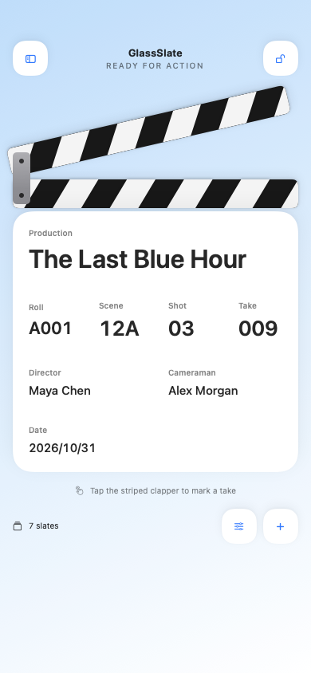
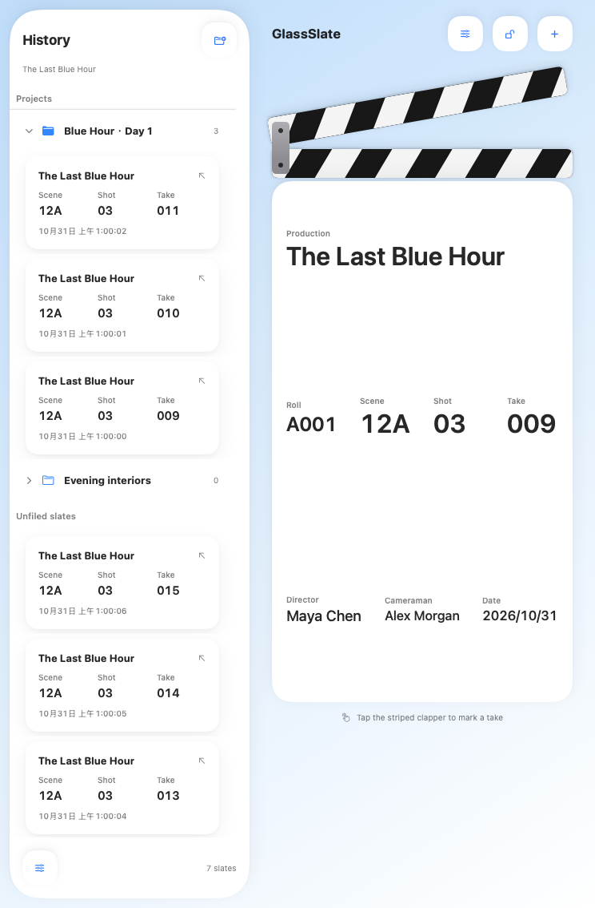
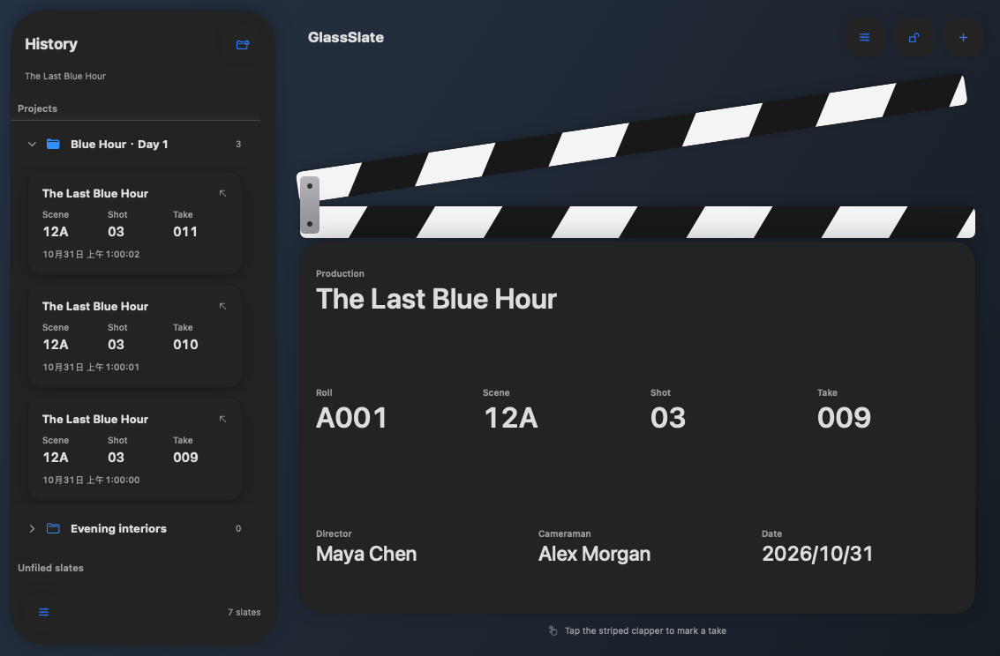

# GlassSlate

English | [简体中文](README.zh-CN.md)

**A native digital clapperboard for iPhone and iPad.**

Built with Swift, SwiftUI, and Apple's native Liquid Glass, GlassSlate brings production details, clapper animation, sound, and take history into one working slate. It supports portrait and landscape layouts, project folders, and an optional classic frosted interface.

[Features](#features) · [Getting started](#getting-started) · [Build and install](#build-and-install) · [Project structure](#project-structure) · [MIT License](LICENSE)

| Item | Details |
| --- | --- |
| Version | 1.0.1 · Build 5 |
| Platform | iPhone and iPad · iOS / iPadOS 26.0 or later |
| Development environment | Xcode 26.5 · macOS Tahoe |
| Language and UI | Swift 6 · SwiftUI |
| Local storage | SwiftData · UserDefaults |
| Localization | English and Simplified Chinese |
| Third-party dependencies | None |
| License | MIT |

## Features

### Slate and clapper

- Edit eight production fields: Production, Roll, Scene, Shot, Take, Director, Cameraman, and Date.
- Tap the striped clapper to play the animation and clap sound while saving a snapshot of the current slate.
- Clap repeatedly: each tap reserves its own take number, and records are persisted in order.
- A retriggerable keyframe animation drives the moving clapper independently of persistence.
- Optionally increment Take after each clap, preserving leading zeros: `009 → 010`. Mixed identifiers such as `02B` remain unchanged.
- Monospaced digits reduce movement when values change; landscape uses a dedicated layout.
- Lock fields to reduce accidental edits and keep the screen awake while the app is active.

### History and projects

- On iPhone and narrow iPad windows, swipe right from the left window edge to open history, or left from the right window edge to close it, in portrait or landscape.
- iPad windows at least 744 pt wide show a permanent 300 pt history sidebar beside the slate. Narrower windows use the drawer.
- Tap a history card to restore its data; long-press for rename, move, and delete actions.
- Create project folders, expand or collapse them, and organize slates using drag and drop or the move menu.
- Long-press or swipe a project to delete it. Choose to keep its slates in Unfiled slates or delete them together; empty projects use a single delete confirmation.
- Display names are separate from production data: renaming a record does not rewrite its eight saved fields.
- A partial left swipe on a slate reveals the system's solid delete button; a full swipe deletes that slate immediately. Project deletion always asks for confirmation.
- A five-second undo action appears after slate or project deletion, then dismisses automatically. Undo preserves any later moves to another project.

### Appearance and localization

- Native Liquid Glass is enabled by default, with a light-blue-to-white background gradient.
- App-owned glass uses the regular native material with a subtle backing to diffuse background text and preserve readable layers. Reduce Transparency and Increase Contrast take precedence; system menus retain their native appearance.
- Choose System, Light, or Dark appearance.
- Turn off Liquid Glass to use a separately designed classic frosted and matte interface.
- History long-press menus use the system's native context menu in both modes, including its current glass appearance.
- After changing the glass preference, close the app from the app switcher and reopen it.
- English and Simplified Chinese follow the system language by default. Choose a separate app language in the native iOS app settings.
- Includes original layered SVG artwork, an Icon Composer `.icon` asset, and icon previews.

### Sound and Live Activities

- Recovers the audio session after interruptions such as Siri, with one rebuild-and-retry if playback fails.
- A bundled classic clap sound, sound preview, custom audio import, and one-tap restoration of the classic sound.
- WAV and M4A are recommended. Imported audio can be up to 30 seconds and 50 MB and is copied into local app storage.
- A native system output-volume control; GlassSlate does not change system volume automatically.
- Live Activities are enabled by default, with a circular clap button on supported Lock Screen and expanded Dynamic Island presentations.
- The Lock Screen view requests native regular glass over a light translucent legibility backing and clears the default opaque host background. Final WidgetKit rendering requires device validation; the system music-player appearance is not an ActivityKit template. Reduced transparency or luminance uses a solid backing.
- Uses public ActivityKit, WidgetKit, and App Intents APIs. Availability and duration are managed by iOS.

## Layout previews

These **1.0.1 classic-mode layout previews** are rendered offscreen on macOS from the shared SwiftUI views, **not iPhone or iPad device screenshots**. They check layout rather than native iOS glass, touch, or animation behavior. Earlier 1.0.0 previews remain in `Previews/` for reference.

<p>
  
  
</p>



## Getting started

1. Open GlassSlate and tap a field to enter production details. Date uses the native date picker.
2. Tap the striped clapper to mark a take. If automatic increment is enabled, the current snapshot is saved before the working slate advances to the next take.
3. Open history to restore a slate. Long-press a card to rename, move, or delete it using the native menu in either visual mode. Holding and moving can begin a drag. On a wide iPad, history stays visible when a slate is restored.
4. Create a project in the drawer and drag slates into its folder, or use the move menu.
5. Open Settings to adjust appearance, glass mode, automatic increment, haptics, sound, and Live Activities.

## Build and install

This repository includes the Xcode project, Live Activity extension, tests, scripts, and resources. After cloning, you can open the project directly without running a generator first.

### With Xcode

```sh
git clone https://github.com/HongHuo0728/GlassSlate.git
cd GlassSlate
open GlassSlate.xcodeproj
```

Select the `GlassSlate` scheme and build with Xcode 26.5. The existing iOS SDK builds both iPhone and iPad support; an iPad simulator runtime is not required. To install on a device, configure your own signing team for both the main app and the `GlassSlateLiveActivity` extension. If necessary, change both bundle identifiers while preserving their parent–child relationship.

`Config/Version.xcconfig` supplies the shared app and extension version. Increase `CURRENT_PROJECT_VERSION` for each new distributed IPA, then rebuild. Failed rebuilds can retain the same candidate build number. Packaging checks the compiled versions against this configuration; `--expected-version` and `--expected-build` support explicit command-line build overrides.

### Build without signing

Build for a generic iOS device without launching a simulator:

```sh
xcodebuild \
  -project GlassSlate.xcodeproj \
  -scheme GlassSlate \
  -configuration Release \
  -destination 'generic/platform=iOS' \
  -derivedDataPath build/DerivedData \
  CODE_SIGNING_ALLOWED=NO \
  build
```

### Package your own IPA

After building, use the included Python 3 script to package and validate an unsigned IPA:

```sh
python3 Scripts/package_ipa.py \
  --app build/DerivedData/Build/Products/Release-iphoneos/GlassSlate.app \
  --output build/GlassSlate-1.0.1-build5-unsigned.ipa
```

Output is written to the local, Git-ignored `build/` directory. An unsigned IPA must be signed before installation. Your signing tool must sign both the main app and `PlugIns/GlassSlateLiveActivity.appex` and retain the embedded extension.

**Built IPA files are not committed to this repository.**

## Tests and checks

Run core data and interaction-policy tests directly on macOS Tahoe without an iOS simulator:

```sh
swift test --scratch-path build/SwiftTests
```

The current suite contains 28 core tests, including parameterized cases for both project-deletion modes. It covers persistence, project and slate undo, failed-write rollback and retry, orphaned membership recovery, field edits interleaved with claps, 50 rapid claps, iPad layout breakpoints, slow edge drags, audio-session recovery and bounded playback retry, persistent settings, and Live Activity payload limits.

Audit localization, audio, and icon resources:

```sh
python3 Scripts/audit_resources.py build/DerivedData
```

Regenerate native macOS layout previews without an iOS simulator:

```sh
python3 Scripts/render_layouts.py
```

Compilation and data tests do not replace device validation. Touch interaction, audio output, glass rendering, and Lock Screen behavior should also be checked after signing and installation. See the [QA notes](docs/QA.md) and [build logs](Logs/) for scope and evidence. Local absolute paths have been removed from the published logs. The detailed QA notes are currently in Simplified Chinese.

## Project structure

```text
GlassSlate/
├── GlassSlate.xcodeproj/       # App, extension, and iOS test targets
├── GlassSlate/
│   ├── App/                   # App entry point
│   ├── Models/                # Slate data, settings, and layout policies
│   ├── Persistence/           # SwiftData and serial persistence
│   ├── Services/              # Audio, haptics, and Live Activity services
│   ├── Views/                 # Slate, drawer, editors, and settings
│   ├── Resources/             # Localization, audio, and privacy manifest
│   ├── Assets.xcassets/
│   └── GlassSlate.icon/       # Native layered app icon
├── Shared/                    # Activity models and intent shared by both targets
├── GlassSlateLiveActivity/    # Lock Screen and Dynamic Island views
├── GlassSlateTests/           # Core regression tests
├── Package.swift             # macOS core-test entry point
├── Config/Version.xcconfig    # Shared marketing version and build number
├── Scripts/                   # Project generation, assets, audits, and packaging
├── Design/                    # Original icon layers and previews
├── Previews/                  # Layout checks and notes
├── Logs/                      # Validation records with local paths removed
├── docs/QA.md
├── README.zh-CN.md            # Simplified Chinese documentation
└── LICENSE
```

After adding, removing, or reorganizing source files, run `python3 Scripts/generate_project.py` to update project references. The script regenerates project configuration, so preserve any custom signing or target settings first.

## Data and platform notes

- Production data, history, projects, and settings are stored locally. No account is required; there is currently no cloud sync or third-party analytics SDK.
- Classic mode is an appearance option. The minimum OS requirement remains iOS 26.0; it does not add iOS 18 compatibility.
- The keyboard, file picker, and system settings are provided by the installed version of iOS.
- Live Activities are managed by the system and are not guaranteed to remain visible indefinitely. Dynamic Island requires device and OS support.
- Audio response depends on device performance and output routes such as Bluetooth; physical zero latency is not guaranteed.

## Feedback and contributions

Bug reports, suggestions, and pull requests are welcome. Please use [Issues](https://github.com/HongHuo0728/GlassSlate/issues) to report a problem.

Include the app version and build, device model, iOS / iPadOS version, whether Liquid Glass is enabled, reproduction steps, and screenshots where possible. For audio issues, also describe the output route.

## License

[MIT License](LICENSE) · Copyright © 2026 紅火
