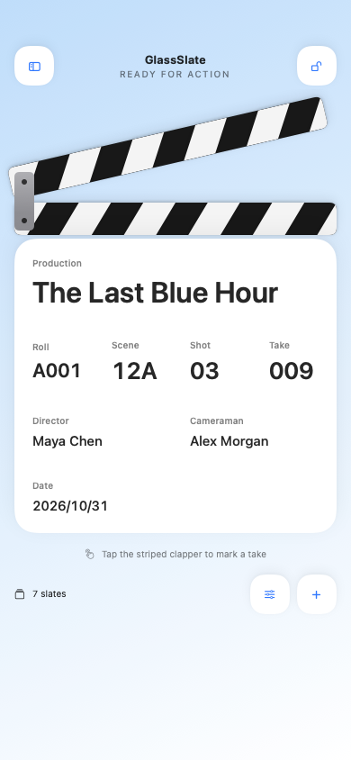
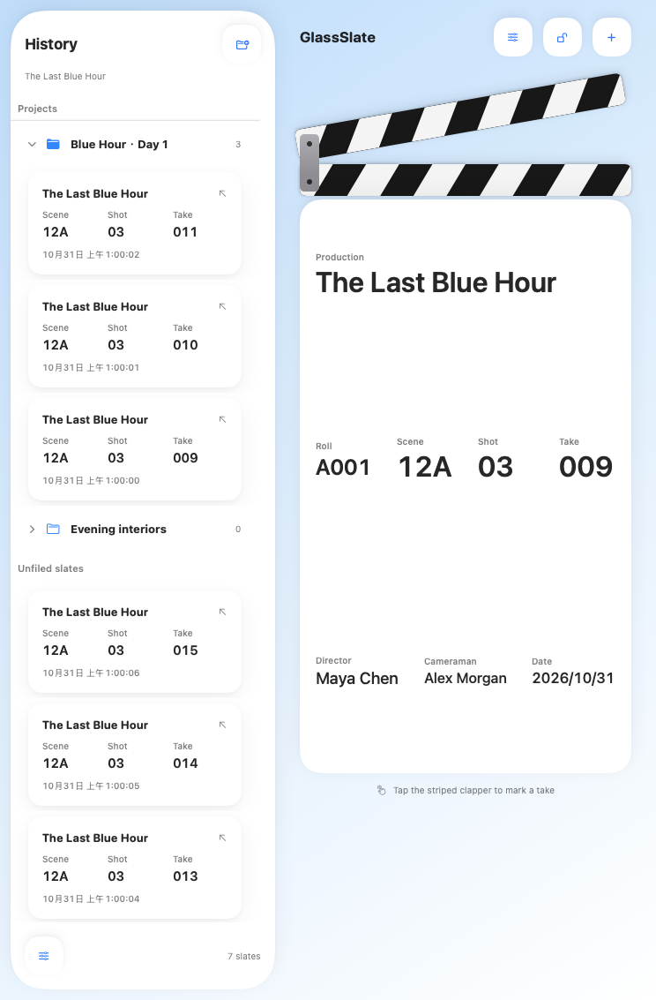
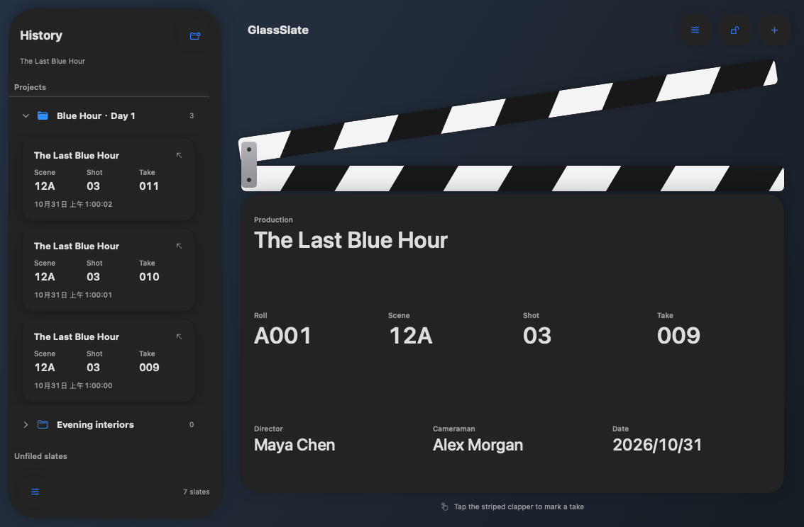

# GlassSlate

[English](README.md) | 简体中文

**一块为 iPhone 和 iPad 设计的原生电子电影场记板。**

GlassSlate 使用 Swift、SwiftUI 和 Apple 原生 Liquid Glass 构建，把拍摄数据、拍板动画、音效与历史记录放进同一个工作界面。支持横竖屏、项目归类，以及可切换的经典毛玻璃界面。

Native iOS clapperboard built with SwiftUI, Liquid Glass, SwiftData, and ActivityKit.

[功能](#功能) · [使用方法](#使用方法) · [构建与安装](#构建与安装) · [工程结构](#工程结构) · [MIT 许可证](LICENSE)

| 项目 | 说明 |
| --- | --- |
| 当前版本 | 1.0.1 · Build 5 |
| 平台 | iPhone 和 iPad · iOS / iPadOS 26.0 及以上 |
| 开发环境 | Xcode 26.5 · macOS Tahoe |
| 语言与界面 | Swift 6 · SwiftUI |
| 数据存储 | SwiftData · UserDefaults |
| 本地化 | 简体中文、English |
| 第三方依赖 | 无 |
| 开源许可 | MIT |

## 功能

### 拍摄与拍板

- 编辑八项拍摄数据：片名 / 制作名称、卷号、场次、镜头、条次、导演、摄影师和日期。
- 轻触斜纹拍板，播放开合动画与音效，同时保存当前场记板快照。
- 支持连续拍板；每次点击独立预留条次，并按顺序持久化记录。
- 拍板臂采用可重复触发的关键帧动画，与数据保存独立执行。
- 可选拍板后自动递增 Take，保留数字前导零：`009 → 010`；混合编号如 `02B` 保持原样。
- 使用等宽数字减少数值切换时的位移；横屏采用独立布局。
- 锁定字段，减少拍摄过程中的误编辑；前台锁定时可保持屏幕常亮。

### 历史与项目

- iPhone 与 iPad 窄窗口中，从窗口左边缘向右滑展开历史抽屉，从右边缘向左滑收起，支持横竖屏。
- iPad 窗口宽度达到 744 pt 时，左侧显示 300 pt 常驻历史栏；更窄的窗口切换为抽屉。
- 点击历史卡片恢复拍摄数据，长按进入重命名、移动和删除操作。
- 新建项目文件夹，展开或收起项目，并通过拖放或菜单归类场记记录。
- 长按或左滑项目可进入删除确认，选择将场记记录保留到未归类，或连同项目一起删除；空项目只显示一个删除选项。
- 显示名称独立于拍摄数据，重命名不会改写原始快照中的八项字段。
- 场记记录局部左滑显示系统实心删除按钮，完整左滑直接删除；项目删除始终需要确认。
- 删除记录或项目后提供五秒撤销入口，超时自动退场；撤销项目不会覆盖用户随后向其他项目进行的移动。

### 外观与本地化

- 默认使用原生 Liquid Glass，背景为浅蓝到白色渐变。
- 自有玻璃使用 regular 原生材质与轻量衬底，扩散背后的文字与高对比内容，保持层次清晰；优先遵守“降低透明度”和“增强对比度”，系统菜单沿用原生外观。
- 支持跟随系统、浅色和深色主题。
- 可关闭 Liquid Glass，切换到独立设计的经典毛玻璃与哑光界面。
- 两种模式下的历史长按菜单均使用当前系统的原生上下文菜单，包括其玻璃外观。
- 更改玻璃模式后，需要在多任务界面关闭 App，再重新打开。
- 简体中文与英语默认跟随系统；单独切换 App 语言通过 iOS 原生 App 设置完成。
- 包含原创分层 SVG、Icon Composer `.icon` 资源及图标预览。

### 音效与实时活动

- Siri 等音频中断后按需恢复会话，播放失败时重建并重试一次。
- 内置经典拍板音效，支持试听、导入自定义音效和一键恢复经典音效。
- 推荐导入 WAV 或 M4A；音频最长 30 秒、最大 50 MB，并复制到 App 本地存储。
- 使用原生系统输出音量控件，不自动修改系统音量。
- 实时活动默认开启，可在支持的锁屏与展开的灵动岛中使用圆形拍板按钮。
- 锁屏内容请求 regular 原生玻璃，清除默认不透明宿主背景并保留轻量半透明可读性衬底。WidgetKit 最终呈现需真机验证，系统音乐播放器样式不是 ActivityKit 模板；降低透明度或亮度时使用实色衬底。
- 使用公开的 ActivityKit、WidgetKit 和 App Intents；可用性与持续时间由 iOS 管理。

## 界面预览

下面展示的是 **1.0.1 经典模式布局预览**，由实际共享的 SwiftUI 视图通过 macOS 离屏渲染生成，**不是 iPhone 或 iPad 真机截图**。用于检查版面，不作为 iOS 原生玻璃、触控或动画的验收结果。1.0.0 的预览保留在 `Previews/` 中供参考。

<p>
  
  
</p>



## 使用方法

1. 打开 GlassSlate，轻触字段填写拍摄数据；日期使用原生日期选择器。
2. 轻触顶部斜纹拍板，记录当前拍摄。若开启自动递增，保存本条快照后工作场记板会切换到下一条次。
3. 打开历史抽屉，点击卡片恢复数据；两种模式下长按均通过系统原生菜单重命名、归类或删除，持续按住并移动可开始拖放。iPad 宽窗口恢复记录后，历史栏保持展开。
4. 在抽屉中新建项目，把记录拖入项目文件夹；也可以通过移动菜单完成归类。
5. 在设置中调整主题、玻璃模式、自动递增、触觉反馈、音效和实时活动。

## 构建与安装

仓库包含完整的 Xcode 工程、实时活动扩展、测试、脚本与资源。克隆后可直接打开工程，无需先运行生成脚本。

### 使用 Xcode

```sh
git clone https://github.com/HongHuo0728/GlassSlate.git
cd GlassSlate
open GlassSlate.xcodeproj
```

选择 `GlassSlate` Scheme，使用 Xcode 26.5 构建。现有 iOS SDK 即可构建 iPhone／iPad 通用 App，无需 iPad 模拟器运行时。安装到设备时，为主 App 与 `GlassSlateLiveActivity` 扩展配置自己的签名 Team；必要时同时修改主 App 和扩展的 Bundle Identifier，并保留父子关系。

`Config/Version.xcconfig` 统一提供 App 与扩展的版本。每次交付新 IPA 时递增 `CURRENT_PROJECT_VERSION` 并重新构建，失败重编可继续使用当前候选构建号。打包脚本会与此配置核对；如通过构建命令覆盖版本，可用 `--expected-version` 和 `--expected-build` 显式指定打包时的预期值。

### 无签名构建

以下命令针对通用 iOS 设备构建，不需要启动模拟器：

```sh
xcodebuild \
  -project GlassSlate.xcodeproj \
  -scheme GlassSlate \
  -configuration Release \
  -destination 'generic/platform=iOS' \
  -derivedDataPath build/DerivedData \
  CODE_SIGNING_ALLOWED=NO \
  build
```

### 自行生成 IPA

构建完成后，可使用仓库内的 Python 3 脚本生成并检查未签名 IPA：

```sh
python3 Scripts/package_ipa.py \
  --app build/DerivedData/Build/Products/Release-iphoneos/GlassSlate.app \
  --output build/GlassSlate-1.0.1-build5-unsigned.ipa
```

生成结果位于本地 `build/`，不会进入 Git。未签名 IPA 需要先签名才能安装；签名工具必须同时处理主 App 和 `PlugIns/GlassSlateLiveActivity.appex`，保留内嵌扩展。

**本仓库不提交构建好的 IPA。**

## 测试与检查

核心数据与交互策略测试可直接在 macOS Tahoe 上运行，无需 iOS 模拟器：

```sh
swift test --scratch-path build/SwiftTests
```

当前包含 28 项核心测试，其中两种项目删除模式使用参数化用例。覆盖持久化、项目与记录撤销、写入失败回滚和重试、失效项目归属修复、编辑与拍板交错执行、快速连续 50 次拍板、iPad 布局临界值、缓慢边缘拖动、音频会话恢复与有限重试、设置持久化与实时活动载荷约束。

检查本地化、音效和图标资源：

```sh
python3 Scripts/audit_resources.py build/DerivedData
```

无需 iOS 模拟器，可重新生成原生 macOS 离屏布局预览：

```sh
python3 Scripts/render_layouts.py
```

编译与数据测试不替代设备端验收。实际触控、声音输出、玻璃效果与锁屏交互仍应在签名安装后验证。检查范围与记录见 [QA 文档](docs/QA.md) 和 [构建日志](Logs/)。日志中的本机绝对路径已去除。

## 工程结构

```text
GlassSlate/
├── GlassSlate.xcodeproj/       # App、扩展和 iOS 测试 Target
├── GlassSlate/
│   ├── App/                   # App 入口
│   ├── Models/                # 拍摄数据、设置与布局策略
│   ├── Persistence/           # SwiftData 与串行持久化
│   ├── Services/              # 音效、触觉与实时活动服务
│   ├── Views/                 # 场记板、抽屉、编辑与设置
│   ├── Resources/             # 双语文案、音效与隐私清单
│   ├── Assets.xcassets/
│   └── GlassSlate.icon/       # 原生分层图标
├── Shared/                    # App 与扩展共享的活动模型和 Intent
├── GlassSlateLiveActivity/    # 锁屏与灵动岛界面
├── GlassSlateTests/           # 核心回归测试
├── Package.swift             # macOS 核心测试入口
├── Config/Version.xcconfig    # App 与扩展共享的版本与构建号
├── Scripts/                   # 工程生成、资源生成、检查与打包
├── Design/                    # 原创图标分层源文件和预览
├── Previews/                  # 布局检查图与说明
├── Logs/                      # 去除本机路径的验证记录
├── docs/QA.md
├── README.md                 # 默认英文说明
├── README.zh-CN.md           # 简体中文说明
└── LICENSE
```

增加、移除或调整源码文件后，可运行 `python3 Scripts/generate_project.py` 更新工程引用。该脚本会重新生成工程配置；如有自己的签名或 Target 调整，请先保留相应修改。

## 数据与平台说明

- 拍摄数据、历史、项目和设置保存在本机；无需登录，当前没有云同步与第三方统计 SDK。
- “经典模式”是外观选项，最低系统要求仍为 iOS 26.0，不代表兼容 iOS 18。
- 系统键盘、文件选择器与系统设置由当前 iOS 提供。
- 实时活动由系统管理，不保证永久显示；灵动岛需要设备与系统支持。
- 音频响应受设备性能与蓝牙等输出路由影响，不承诺物理零延迟。

## 反馈与贡献

欢迎通过 [Issues](https://github.com/HongHuo0728/GlassSlate/issues) 提交问题和建议，或发起 Pull Request。

报告问题时，请尽量附上 App 版本与构建号、设备型号、iOS / iPadOS 版本、玻璃模式是否开启、复现步骤和截图；音效问题可同时说明输出路由。

## License

[MIT License](LICENSE) · Copyright © 2026 紅火
